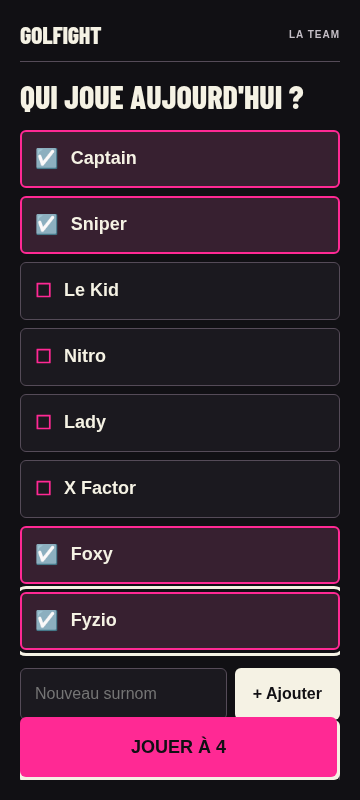
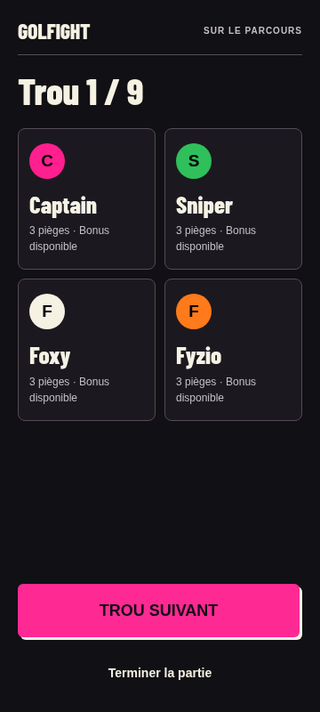
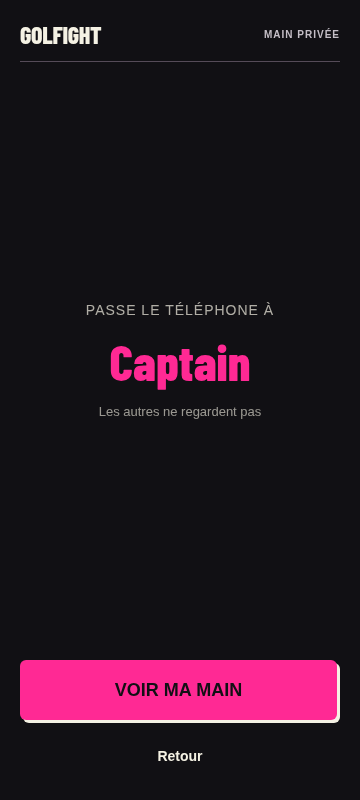
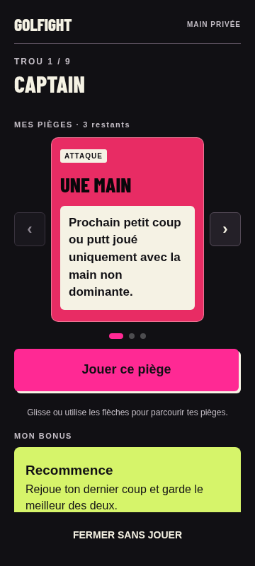

# Lot 1 — Revue pour validation

**Lot 1 livré, prêt à être revu. Lot 2 non engagé. Aucun merge ni déploiement.**

## Les quatre écrans

- Joueurs : surnoms de 18 px, sélection rose et état annoncé, champ d'ajout lisible et formats 9/18 distingués. Le focus clavier reste sur le surnom sélectionné.
- Tableau : trou en cours en tête, tuiles lisibles et sans pulsation, pièges et bonus restants explicites. Les tuiles épuisées restent consultables ; aucune règle de jeu n'est changée.
- Passage privé : écran existant conservé, nom du destinataire visible, aucune carte exposée. Aucune nouvelle étape.
- Main : corail/violet selon catégorie, effet de 17 px sur fond clair, titres condensés, flèches tactiles de 44×48 px avec libellés accessibles. Navigation clavier avec focus conservé, action principale de 60 px, fermeture disponible en bas. Le bonus personnel dans la main utilise le citron ; son écran d'annonce n'est pas refondu.

Les styles sont isolés dans assets/lot1.css et limités à ces quatre écrans. Accueil, attaque, choix de cible, annonces bonus/chaos et fin ne sont pas redessinés. GOLFIGHT reste en un mot ; aucun écusson ni splash.

## Captures représentatives — 360 × 800

### Joueurs

### Tableau central

### Passage privé

### Main — effet long

Cette dernière capture emploie une carte contrôlée « Une main » pour vérifier un effet long. Les captures utilisent des noms fournis et des parties de démonstration.

## Vérifications exécutées

- Tests existants : 13 groupes fonctionnels, 14 contrôles visuels, 16 groupes d'audit complet et les trois catégories de reprise attaque/chaos/bonus passent.
- La matrice d'audit couvre les quatre écrans à 320×568, 360×800, 390×844 et 800×360 ; zoom de page à 150 % et textes à 150 % par styles injectés. Aucun débordement horizontal ; boutons d'au moins 44 px atteignables après défilement. Les textes longs, les marges de sécurité simulées et les erreurs de stockage restent couverts.
- tests/lot1.cjs exécuté : sélection clavier Captain/Sniper/Foxy/Fyzio avec maintien du focus et aria-pressed ; choix de format ; ouverture clavier du passage ; navigation des cartes sans consommation ni modification de sauvegarde ; masquage de la main après fermeture. Le maintien du focus des flèches a été corrigé puis retesté.
- Comparaison de source avant/après lot : démarrage, consommation, confirmation, fin, fonctions de sauvegarde, validation et reprise d'annonce strictement identiques. Les modifications JavaScript concernent la présentation, le focus et les libellés accessibles uniquement.
- Les quatre captures ont été inspectées visuellement.

Résultats : [fonctionnel](tests/results.json), [visuel](tests/visual-results.json), [audit](tests/audit-results.json), [reprise](tests/recovery-results.json), [lot 1](tests/lot1-results.json).

## Défauts et limites restants

Aucun blocage fonctionnel reproduit dans ces contrôles. Les huit surnoms, les options et les actions ne tiennent pas tous simultanément sur un petit écran : le défilement reste nécessaire. La main et le bonus peuvent également demander un défilement, particulièrement en paysage ou avec texte agrandi. Les zones de bas d'écran disposent d'une réserve de défilement ; elles ne remplacent pas un contrôle avec le vrai clavier mobile.

Les réglages de texte natifs iOS/Android, le plein soleil, les reflets, les appels et les gestes au pouce sur appareil physique restent à tester avant diffusion. La fermeture complète du navigateur reste simulée dans les tests de reprise, sans arrêt réel du système.

## Décision attendue

Valider ou ajuster ces quatre écrans avant d'autoriser le lot 2 : choix de cible, annonces bonus/chaos, fin. Le moteur et la reprise corrigée restent la référence à préserver.
