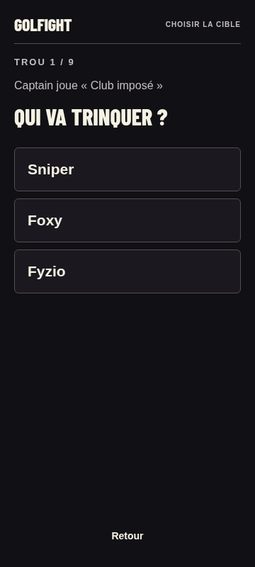
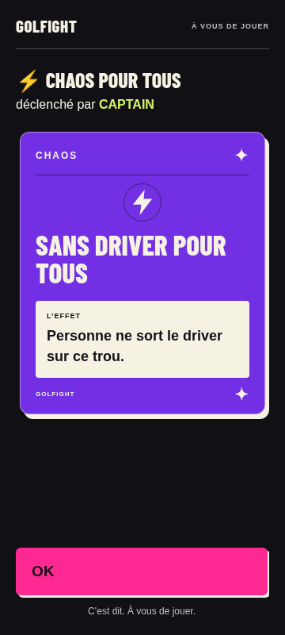
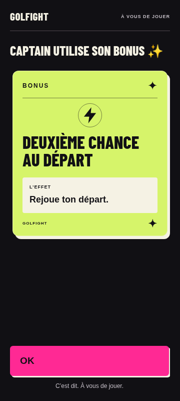
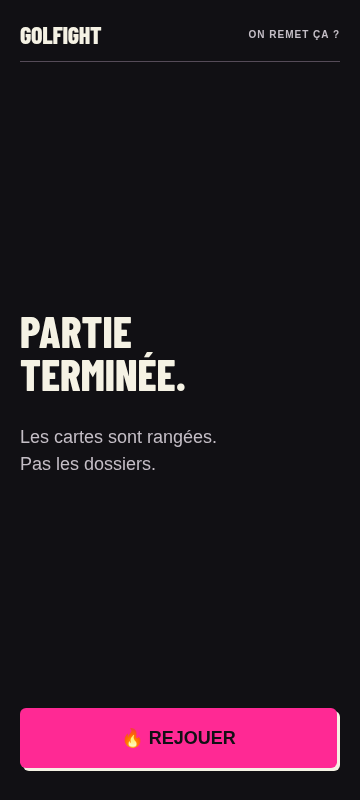

# Lot 2 — Harmonisation terminée, place au test Team

**L'application est harmonisée de bout en bout et prête pour une partie test sur téléphone.** Cela ne constitue pas une validation physique ni une autorisation de diffusion. Travail sur golfight-v2-visual uniquement ; aucune fusion ou mise en ligne.

## Écrans livrés

- Cible : nom de l'attaquant et de la carte au-dessus des victimes. L'auteur est exclu de la liste comme auparavant. Retour annule la sélection sans consommation.
- Chaos et bonus : réutilisation du composant d'annonce de l'attaque, violet et citron, effet de 18 px sur fond clair, bouton OK de 60 px. Le titre long du bonus a conduit à réduire le décor et la taille du titre pour conserver OK visible à 360×800. Sur écran court, le pictogramme décoratif est masqué.
- Fin : conclusion courte et bouton Rejouer existant, sans classement ni étape supplémentaire.

Aucune nouvelle feuille CSS : composant partagé dans visual-pilot.css et navigation dans lot1.css. Aucun changement de carte, règle, clé ou contenu sauvegardé. Comparaison de source : démarrage, consommation, sauvegarde, validation, confirmation et reprise des annonces sont identiques au début de ce lot. Seule une ligne de présentation est ajoutée lors du choix d'une cible.

## Captures représentatives — 360 × 800

### Cible

### Chaos

### Bonus — titre long

### Fin

Ces captures ont été inspectées visuellement. Le bonus long est une donnée contrôlée du test ; les cartes attaque et chaos sont placées depuis le paquet disponible pour garantir la couverture des catégories.

## Non-régression exécutée

Les suites verify, visual, recovery, lot1 et audit passent : gameplay, quatre parcours à 2/4 joueurs sur 9/18 trous, confidentialité, ancienne sauvegarde, reprise d'attaque/chaos/bonus sans double consommation, sélection et navigation clavier. La matrice est passée à 320×568, 360×800, 390×844 et 800×360, avec zoom de page à 150 %, textes agrandis par styles injectés à 150 %, marges de sécurité simulées et effets longs.

La nouvelle suite tests/lot2.cjs exécute un parcours complet sur tous les écrans : sélection de quatre joueurs, passage et main, attaque sur Sniper au clavier, rechargement/reprise, chaos, bonus, confirmations, progression jusqu'à neuf trous, fin et Rejouer. Les contrôles confirment l'auteur identifié, trois cibles sans l'auteur, les annonces restaurées, la sauvegarde supprimée en fin, puis la relance sans ancien bouton Reprendre.

Résultats : [lot 2](tests/lot2-results.json), [reprise](tests/recovery-results.json), [audit](tests/audit-results.json), [fonctionnel](tests/results.json), [visuel](tests/visual-results.json), [lot 1](tests/lot1-results.json).

## Anomalies et limites restantes

Aucun blocage reproduit dans ces contrôles. Avec un écran court, le clavier ouvert ou du texte agrandi, le défilement reste nécessaire. Les contrôles de largeur et d'accès après défilement ne suffisent pas à garantir le confort au pouce. Les réglages natifs du texte, les reflets, les appels réels, Safari et la fermeture forcée du téléphone ne sont pas validés. Le stockage demeure local au navigateur et à l'adresse utilisée.

La reprise de fermeture complète est simulée par réinjection du stockage dans un nouveau contexte de navigateur, sans redémarrage physique. Un effacement des données ou une écriture impossible ne peuvent pas être compensés par cette application locale ; l'alerte existante reste prévue.

## Procédure de test smartphone avec la Team

### Préparer, sans déploiement

1. Télécharger la branche golfight-v2-visual depuis GitHub (Code → Download ZIP), puis extraire le dossier sur un ordinateur équipé de Python 3.
2. Ouvrir un terminal dans ce dossier et lancer `python3 -m http.server 8000 --bind 0.0.0.0` sur un réseau local de confiance.
3. Connecter le téléphone au même Wi-Fi. Ouvrir `http://ADRESSE_IP_LOCALE_ORDINATEUR:8000` dans son navigateur habituel ; ne pas utiliser l'aperçu GitHub, une navigation privée ou l'ouverture directe du fichier HTML. Autoriser le serveur dans le pare-feu local si nécessaire.
4. Garder l'ordinateur et le serveur actifs. Conserver exactement le même navigateur, la même adresse et le même port pour les reprises. Un autre appareil ou une autre adresse ne retrouve pas cette sauvegarde.

Le test local exige que l’ordinateur reste joignable. Pour neuf trous sur le parcours, prévoir un réseau portable disponible pendant toute la partie ou autoriser ensuite un hébergement de test. Aucun mode hors ligne installable n’est livré ; vérifier la reprise dans ces conditions avant de partir.

### Vérifier pendant dix minutes, puis jouer neuf trous

1. Choisir quatre joueurs, vérifier Foxy/Fyzio ou ajouter un surnom, puis démarrer neuf trous. Vérifier la lecture avec les réglages habituels du téléphone.
2. Passer le téléphone : personne ne doit voir la main précédente. Ouvrir une main, parcourir les pièges, fermer sans jouer ; aucun stock ne doit changer.
3. Jouer une attaque et lire ensemble l'auteur, la victime et l'effet. Avant OK, changer d'application puis recharger la page et reprendre : la même annonce doit revenir et la carte ne doit pas être consommée deux fois. Confirmer ; l'annonce ne doit plus revenir à la reprise suivante.
4. Faire le même essai avec un chaos et un bonus lorsqu'ils se présentent. Comparer les stocks avant/après. Ne pas modifier les règles pour provoquer une carte particulière.
5. Essayer au pouce, en extérieur, puis avec un agrandissement de texte et en paysage. Vérifier particulièrement les actions en bas de l'écran et l'ajout de surnom avec le clavier ouvert.
6. Jouer les neuf trous normalement, sans imposer le téléphone à chaque trou. Finir puis relancer une partie pour vérifier l'effacement de l'ancienne et le maintien des surnoms.

Pour le retour Team : noter téléphone/navigateur, étape, ce qui a freiné la partie, éventuelle mauvaise cible, main exposée ou annonce perdue. L'objectif est de lire, choisir, confirmer puis ranger le téléphone rapidement — pas de chercher de nouvelles retouches décoratives.

**Suite recommandée : réaliser cette partie test avant tout nouveau chantier esthétique ou diffusion.**
