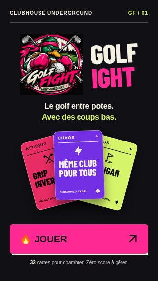
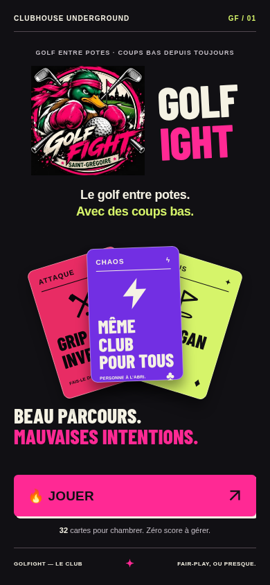
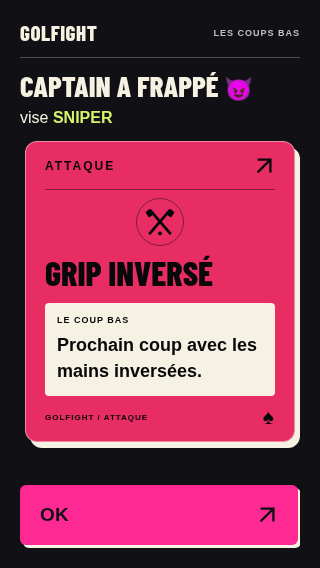
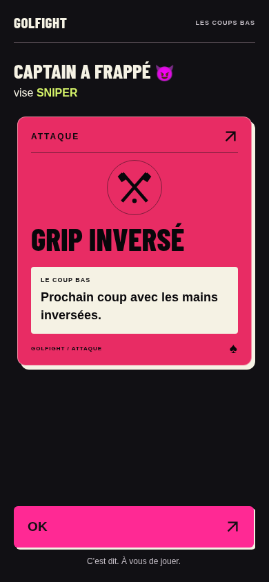

# Revue des pilotes — Écusson original

**Archive : cette proposition a été remplacée. Voir [la révision actuelle sans écusson](REVUE-GOLFIGHT.md).**

Statut : version à revoir, sur `golfight-v2-visual` uniquement. Aucun merge, aucun déploiement, aucune refonte des autres écrans. Le test sur téléphone physique n'a pas été effectué dans cet environnement.

## Captures finales inspectées

Les quatre comparatifs historiques [du premier pilote](VISUAL-2.1.md#captures-comparatives) sont conservés sans modification. Les captures de cette révision sont ajoutées séparément.

| Écran | 320 × 568 | 390 × 844 |
|---|---|---|
| Accueil avec écusson | [Voir](visual/revision-ecusson/accueil-320.png) | [Voir](visual/revision-ecusson/accueil-390.png) |
| Attaque, effet prioritaire | [Voir](visual/revision-ecusson/attaque-320.png) | [Voir](visual/revision-ecusson/attaque-390.png) |

### Accueil — 320 px

### Accueil — 390 px

### Attaque — 320 px

### Attaque — 390 px

## Modifications

- Réutilisation exacte, sans retouche ni redessin, du JPEG déjà embarqué dans le prototype d'origine. Fichier local assets/golfight-ecusson-original.jpg, 640 × 616, 106 795 octets. SHA-256 : `cb3b752cab83a20c9d7fd14162e10e292ae68ae802161dcb89c7753ad26dcf7b`.
- Écusson identifiable dans l'en-tête : 128 px de large à 320 × 568, 164 px à 390 × 844 ; logo typographique en accompagnement. Aucun recadrage du canard ni du nom Saint-Grégoire.
- Éventail réduit sur petit écran ; aucun chevauchement avec le slogan ou le bouton. Texte décoratif « Beau parcours » masqué sur écran court pour laisser l'espace à l'écusson, au slogan et aux actions. Accueil initial et bouton Jouer entièrement visibles sans défilement aux deux tailles testées.
- Effet de la carte d'attaque porté à 18 px, sur fond blanc cassé, ligne à 1,45. Pictogramme réduit à 80 px, et 48 px sur écran court : le décor cède la place au texte. Effets longs lisibles par défilement, sans réduction de police.

## Vérifications réalisées

- Les 13 groupes de la suite fonctionnelle existante passent sous Chromium.
- Les 14 contrôles de la suite visuelle passent : les 12 précédents plus un contrôle de l'écusson, de la visibilité complète de l'action et de l'absence de chevauchement pour chaque largeur.
- Captures finales à 320 × 568 et 390 × 844 inspectées visuellement. Les essais couvrent notamment une attaque à effet long, la confidentialité de la main et le mouvement réduit.
- Script JavaScript intégralement identique à golfight-v2 : cartes, règles, sauvegarde et reprise inchangées.
- Écusson extrait vérifié identique octet pour octet au fichier original embarqué ; quatre comparatifs historiques vérifiés identiques à ceux du commit pilote précédent.

Résultats bruts : [tests fonctionnels](tests/results.json), [contrôles visuels](tests/visual-results.json). Commandes : `node tests/verify.cjs` et `node tests/visual.cjs`, avec le serveur local et les mêmes prérequis que dans README.md.

## Test physique restant à faire

Suivre les instructions [du README](README.md#test-sur-smartphone) pour ouvrir le prototype depuis un ordinateur et un téléphone sur le même réseau local. Ne pas ouvrir les fichiers HTML dans l'aperçu de GitHub pour tester le jeu.

Sur le vrai téléphone : vérifier l'écusson et le bouton Jouer en portrait ; reprendre une partie ; passer le téléphone à un joueur et vérifier l'écran de confidentialité ; lire une attaque simple puis un effet long, à une main et en extérieur ; confirmer la carte ; fermer et rouvrir la même adresse pour vérifier la reprise. Essayer aussi le réglage système de réduction des animations et l'agrandissement du texte.

Ces conditions physiques, Safari iOS et la lisibilité en plein soleil restent non validés. Une validation humaine de ces pilotes reste nécessaire avant d'étendre le design aux joueurs, à la main, aux bonus, au chaos et à la fin.
