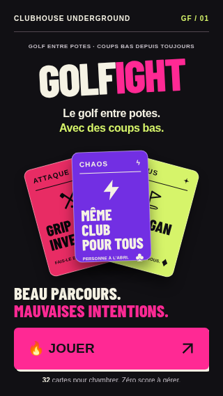
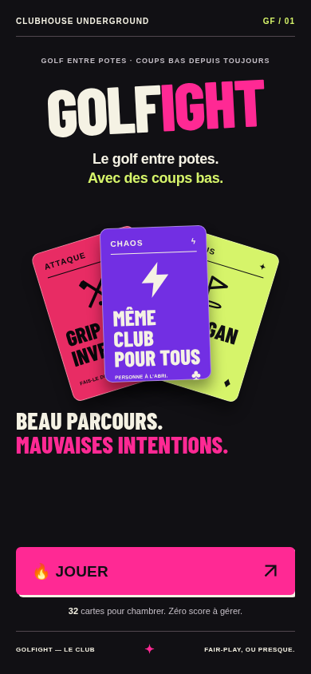

# Révision actuelle — GOLFIGHT en un mot

L'écusson est retiré de l'accueil. Il reste uniquement une référence graphique pour les couleurs et l'esprit du jeu. Le nom GOLFIGHT est affiché en un seul mot, sur une ligne, aux deux largeurs testées.

La lisibilité de l'effet des attaques à 18 px et le pictogramme réduit sont conservés. Les cartes, les règles et les fonctions de sauvegarde demeurent identiques à golfight-v2. La navigation et l’accessibilité ont ensuite reçu des corrections ciblées, détaillées dans [l’audit courant](AUDIT.md).

Les 14 contrôles visuels passent sous Chromium : marque sans écusson, absence de retour à la ligne ou chevauchement, actions visibles, contrastes, navigation des attaques, main secrète et mouvement réduit. Les tests physiques et le plein soleil restent à vérifier. Aucun merge, aucun déploiement ni généralisation.

## Captures actuelles

### 320 × 568 px

### 390 × 844 px

Les quatre [comparatifs historiques](VISUAL-2.1.md#captures-comparatives) restent intacts. Les captures de la proposition précédente sont conservées en archive et ne représentent plus l'accueil actuel.
